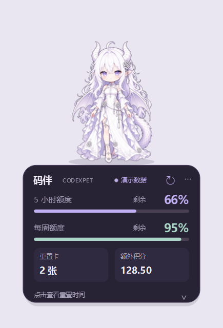
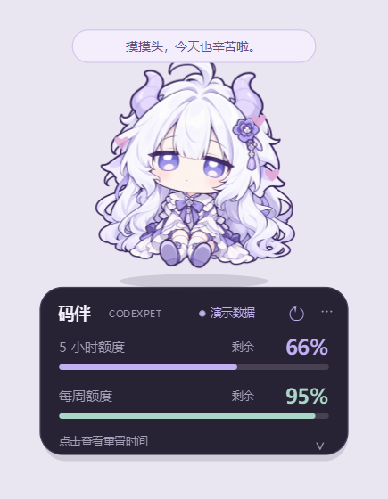

# CodexPet · 码伴

Windows 透明悬浮桌宠：显示 Codex 额度，支持两种形象切换、拖动、摸头、呼吸动画与托盘。

白龙形象摸头时轻晃，圆脸 Q 版摸头时上下弹跳。所有互动均在本地完成，不调用模型。

| 白龙形象 | 圆脸 Q 版 |
| --- | --- |
|  |  |

## 开始使用

从 [Releases 下载 Windows EXE 完整包](https://github.com/Leezxrc/CodexPet/releases/latest)，将 ZIP 完整解压后使用。

使用打包版：进入 **app\CodexPet** 双击 **CodexPet.exe**。
保留整个 `app\CodexPet` 文件夹，尤其是相邻的 `_internal` 运行库。无需安装 Python。

添加到开始菜单：在项目目录运行 `powershell -ExecutionPolicy Bypass -File tools\install-start-menu.ps1`。随后在 Windows 开始菜单搜索 **码伴** 或 **CodexPet** 即可启动。此脚本只为当前用户创建快捷方式，不需要管理员权限。移动项目目录后重新运行脚本即可更新路径。

使用源码：安装 Python 3.12，在项目目录执行 `python -m venv .venv`，然后执行 `.\.venv\Scripts\python.exe -m pip install -r requirements.txt` 和 `.\.venv\Scripts\python.exe src\main.py`。Git 仓库不包含 `.venv` 和打包运行库。

本机已经验证可以读取 Codex CLI 的真实额度。码伴读取 **CLI 当前登录的 ChatGPT 账号**；如果 CLI 和 Codex 桌面应用登录了不同账号，显示的用量也会不同。首次启动约需几秒，之后每两分钟刷新一次。仅显示百分比与重置时间，不估算剩余消息条数。

## 怎么操作

| 操作 | 效果 |
| --- | --- |
| 点击头部 | 摸头：白龙轻晃，圆脸 Q 版上下弹；两者均冒爱心、显示本地短句 |
| 右键 → 切换形象 | 选择白龙或圆脸 Q 版，立即生效并记住选择 |
| 按住角色或卡片拖动 | 移动桌宠，松开后记住位置 |
| 点击额度卡片 | 展开 / 收起两项重置倒计时 |
| 点击卡片右上角 ↻ | 立即刷新真实额度 |
| 右键或点击 ⋯ | 调整置顶、大小、呼吸动画，查看连接帮助或退出 |
| 托盘图标单击 | 找回隐藏的桌宠 |
| 再次启动 | 显示已有桌宠，不重复创建窗口 |

右键支持 80%、100%、125%、150% 大小。若文字偏小，选择 125% 或 150%。
本版的摸头是程序驱动的轻晃 / 弹跳与爱心反馈；呼吸是轻微上下浮动，还不是逐帧眨眼、行走或自由聊天。

## 额度与连接状态

- 按服务返回的实际窗口显示，如“5 小时额度”和“每周额度”。剩余量 = 100% − 已用比例。
- 两条额度同时限制账号，不相加。它们是账号共享的用量窗口，不是本次聊天的独立额度。
- **已同步**：本次成功读取；详情显示最后更新时间。桌宠不是实时逐秒同步，通常每两分钟更新。
- **旧数据 / 待刷新**：请求失败、上次数据超过五分钟或已过重置时间。卡片标记“上次”，不会虚构恢复为 100%。失败时旧数据也可能属于此前登录的账号。
- **—**：服务没有提供该项数据，不代表剩余为零。
- 倒计时本地更新，日期按运行电脑的本地时区显示；恢复网络后自动重试，也可手动刷新。

若未连接，先在终端执行 `codex login`，使用你的 ChatGPT 账号登录，再刷新。尚未安装 CLI 时需先安装 Node.js，然后执行 `npm install -g @openai/codex`。普通 API Key 登录可能不提供 ChatGPT 套餐额度。

程序自动定位 PATH 或 npm 全局目录中的原生 `codex.exe`；也可右键“选择 codex.exe”指定路径，或者在启动前设置 `CODEXPET_CODEX_EXE` 环境变量。选择的文件必须是原生 exe，而不是 `.cmd` / `.ps1` 包装器。

## 本地文件与隐私

- `app\CodexPet\`：可运行的软件和随附运行库。
- `src\`：源码；`tests\`：额度、进程协议与交互测试。
- `assets\pet-v2.png`：白龙形象；`assets\pet-chibi.png`：圆脸 Q 版。
- `docs\`：设计、素材提示词与验证记录。
- `data\settings.json`：形象、位置、大小、置顶、动画和自选 CLI 路径。项目目录不可写时，设置回退至 `%LOCALAPPDATA%\CodexPet`。
- `.venv\`、`build\`、`tools\`：开发和打包文件；普通使用无需打开。

码伴不读取或复制认证文件，不保存额度快照、账号邮箱或原始服务日志。它通过本机 CLI 的 app-server 初始化握手后，只调用 `account/rateLimits/read`，然后关闭自己启动的子进程。不会发送聊天请求、执行任务或消耗额度重置券。摸头和动画不调用模型。

每次读取使用独立、隐藏的短生命周期子进程。网络请求最长等待 25 秒，随后进行有界的进程清理。关闭桌宠也会取消其正在进行的读取。

## 开发与验证

在本目录运行：

```powershell
.\.venv\Scripts\python.exe -m unittest discover -s tests -v
.\.venv\Scripts\python.exe src\main.py
.\.venv\Scripts\python.exe src\main.py --demo
.\.venv\Scripts\python.exe src\main.py --preview docs\preview-demo.png
.\.venv\Scripts\python.exe src\main.py --check docs\source-live-check.json
powershell -ExecutionPolicy Bypass -File tools\build.ps1
```

`--demo` 和 `--preview` 会明确显示“演示数据”，不读取账号。`--check` 只做一次真实读取，输出不含凭据的报告与界面截图后退出。运行 GUI 检查时使用正常 Windows 桌面环境；Qt offscreen 平台可能没有系统中文字体。

新开发环境可使用 Python 3.12 创建 `.venv`，然后安装 `requirements.txt`。打包脚本将 PATH 临时限制为 Windows 系统目录，以避免混入其他软件的 Qt DLL。

官方协议参考：https://learn.chatgpt.com/docs/app-server#6-rate-limits-chatgpt

这是本地自用的独立桌宠项目。素材参考用户提供的形象，功能和交互由本项目实现。
