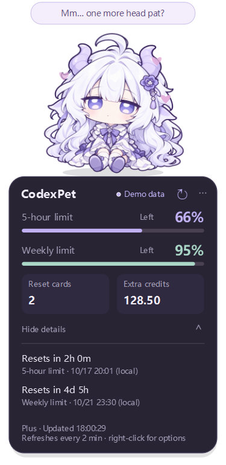
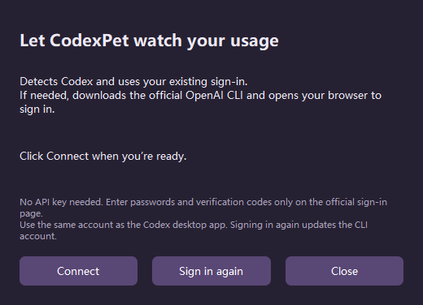

# CodexPet

**English** | [简体中文](docs/README.zh-CN.md) | [Türkçe](docs/README.tr.md)

A transparent Windows desktop companion that keeps your **Codex usage limits, reset cards and extra credits** in view. Switch between a white dragon and a chibi character, drag your companion around, and give it a head pat.

**[Download for Windows](https://github.com/Leezxrc/CodexPet/releases/latest)** · [Getting started](#getting-started) · [Controls](#controls)

New in **v0.5.0**: Simplified Chinese, English and Turkish throughout the app. Right-click → **语言 / Language / Dil** to switch instantly; your choice is remembered. This introduction opens in English by default. Use the links above to read another language.



*Preview uses demo data. Head pats and animations run locally without calling a model.*

## Getting started

1. Download the [complete Windows ZIP](https://github.com/Leezxrc/CodexPet/releases/latest) and extract the entire folder. You can also clone this repository, which includes the runnable app and its runtime.
2. Open **`app/CodexPet/CodexPet.exe`**, or double-click **`启动码伴.vbs`** at the project root. Keep the adjacent **`_internal`** folder. Python is not required.
3. Right-click the pet → **语言 / Language / Dil** → **English**. The app starts in Chinese until you choose another language; this website’s default language does not change your app settings.
4. Select **Connect to Codex…** → **Connect**. Existing CLI sign-in is reused. If the CLI is missing, CodexPet downloads the official portable version; if you are signed out, your browser opens for ChatGPT authorization.

Use the **same ChatGPT account as your Codex desktop app**. CodexPet reads the account signed in to the local CLI, which may otherwise be different. Automatic setup requires neither Node.js nor administrator access and does not change your system PATH. The first download may take a few minutes; progress is shown and you can cancel it. To change accounts or renew sign-in, choose **Sign in again**; this updates the local CLI sign-in.



### Add to the Start menu

Run this command from the project folder:

```powershell
powershell -ExecutionPolicy Bypass -File tools\install-start-menu.ps1
```

Search the Start menu for **CodexPet** or **码伴**. The shortcut is created for your Windows user without administrator access. Run the script again after moving the folder.

## Controls

| Action | Result |
| --- | --- |
| Click the head | White dragon: gentle sway. Chibi: feet stay anchored while the body compresses downwards, widens and springs back. Both show hearts and a short message. |
| Right-click → Appearance | Switch between the white dragon and chibi; your choice is saved. |
| Right-click → 语言 / Language / Dil | Choose Simplified Chinese, English or Turkish without reconnecting. |
| Hold and drag | Move the pet; its position is saved on release. |
| Click the usage card | Expand or collapse reset times. |
| Click ↻ | Refresh usage immediately. |
| Right-click → Connect to Codex… | Detect or install the CLI, check sign-in and connect. |
| Click the connection-issue footer | Open the connection window. |
| Right-click or click ⋯ | Adjust size, always-on-top or idle animation; open help or quit. |
| Click the tray icon | Show the hidden pet. |
| Launch again | Show the existing instance instead of opening a duplicate. |

Sizes: **80%, 100%, 125% and 150%**. Choose a larger size if the text is too small. Current animations provide idle movement and head-pat feedback; walking, frame-by-frame blinking and free-form chat are not implemented.

## Understanding usage

- **Usage limits** follow the windows returned by Codex, such as a 5-hour window and a weekly window. Remaining usage is `100% − used percentage`. These are shared account limits, not separate allowances for this chat, and are not added together.
- **Reset cards** show the available count returned by the service. Redeem them in Codex; this app only displays the count. Eligibility, expiry and the effect of redemption are determined by Codex.
- **Extra credits** show the service’s credits balance to two decimal places. This is not money or an estimate of remaining messages. “Unlimited” appears only when explicitly reported by the service.
- **Unavailable / —** means the service did not supply that value; it is not treated as zero. Older CLIs may not supply reset-card data.
- **Synced** means the latest read succeeded. Usage refreshes every two minutes; the details show its last update time.
- **Outdated / Refresh due** means a read failed, data is over five minutes old, or a reset time has passed. Previous results remain marked as old, without inventing a restored balance. They may belong to a previously signed-in account.
- Reset countdowns update locally. Dates use the computer’s local time zone; Turkish uses day-first dates and decimal commas.

## Connection help

Start with **Connect to Codex…**. If automatic download fails, install the official CLI yourself and use **Choose codex.exe…**. If the browser does not open, run `codex login` in a terminal and retry. API-key sign-in cannot supply ChatGPT plan usage; the connection dialog offers **Sign in with ChatGPT** when needed.

CodexPet searches PATH, the user’s `.local\bin` and npm global installation folders for the native CLI. You can also choose a file manually or set `CODEXPET_CODEX_EXE` before launch. Select the native **`codex.exe`**, not a `.cmd` or `.ps1` wrapper.

You can start a closed app with `CodexPet.exe --language en` or `CodexPet.exe --language tr`. When the app is already running, use its language menu.

## Project layout and privacy

```text
CodexPet/
├─ 启动码伴.vbs                 Double-click launcher
├─ app/CodexPet/
│  ├─ CodexPet.exe              Windows application
│  └─ _internal/                Required runtime and bundled assets
├─ src/                        Source code
├─ assets/                     Character images
├─ docs/                       Localized guides and previews
├─ tools/                      Build, validation and Start menu scripts
├─ tests/                      Automated tests
└─ README.md                   English introduction
```

Settings are saved in **`data/settings.json`**: language, appearance, position, size, always-on-top, animation and a custom CLI path. If the project folder is read-only, storage falls back to **`%LOCALAPPDATA%/CodexPet`**. Downloaded CLI files live under `data/runtime/codex/`; official release checksums are verified before installation. Local settings, downloads, `.venv/`, `build/` and `releases/` are excluded from Git.

CodexPet does not read or copy credential files or save account email addresses or raw service logs. It reads usage through the local CLI app-server’s `account/rateLimits/read` method and checks sign-in with `account/read`. The official `codex login` flow handles authentication and credential storage; passwords and verification codes are entered only on the official sign-in page.

The app does not send chat requests, execute coding tasks or redeem reset cards. Reads use hidden, short-lived subprocesses with bounded timeouts and cleanup. Closing the pet cancels its active read. Browser sign-in waits up to five minutes; cancelling stops the login process started by CodexPet, though an authorization already completed in the browser may have been saved by the CLI.

## Development and validation

Use Python 3.12 from the project folder:

```powershell
python -m venv .venv
.\.venv\Scripts\python.exe -m pip install -r requirements.txt
.\.venv\Scripts\python.exe -m unittest discover -s tests -v
.\.venv\Scripts\python.exe src\main.py --language en
.\.venv\Scripts\python.exe src\main.py --demo --language tr
.\.venv\Scripts\python.exe src\main.py --preview build\preview-en.png --language en
.\.venv\Scripts\python.exe src\main.py --check docs\source-live-check.json
powershell -ExecutionPolicy Bypass -File tools\build.ps1
```

`--demo` and `--preview` use clearly labelled offline sample data. `--check` performs one real usage read and saves a redacted report and screenshot before exiting; diagnostic reports are excluded from Git. GUI checks should run in a normal Windows desktop session. The build script isolates PATH from unrelated Qt DLLs.

v0.5.0 validation covered 40 automated tests, a packaged run in an isolated runtime environment, three-language previews, real usage retrieval, single-instance activation and stale-lock recovery.

An independent desktop companion project, with character artwork based on user-provided references.
