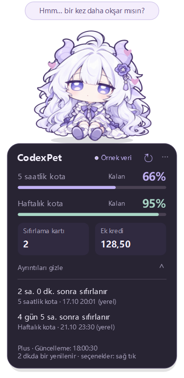
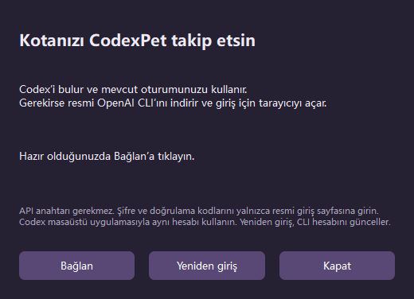

# CodexPet

[English](../README.md) | [简体中文](README.zh-CN.md) | **Türkçe**

Codex kotasını, sıfırlama kartlarını ve ek kredileri gösteren bir Windows masaüstü arkadaşı. İki görünüm, baş okşama, sürükleme, sistem tepsisi menüsü ve tek tıkla bağlantı içerir.

**v0.5.0:** Uygulama Basitleştirilmiş Çince, İngilizce ve Türkçeyi destekler. GitHub ana sayfası varsayılan olarak İngilizce açılır; yukarıdaki bağlantılarla tanıtım dilini değiştirebilirsiniz. Bu seçim uygulamanın kayıtlı dilini değiştirmez.

## Başlangıç

1. [Windows sürümünü](https://github.com/Leezxrc/CodexPet/releases/latest) indirip tamamen çıkarın veya deponun tamamını klonlayın.
2. `app/CodexPet/CodexPet.exe` dosyasını açın. Yanındaki `_internal` klasörünü koruyun. Python gerekmez.
3. Karaktere sağ tıklayın → **语言 / Language / Dil** → **Türkçe**. Seçiminiz hemen uygulanır ve kaydedilir.
4. **Codex’e bağlan…** → **Bağlan** seçeneğini kullanın. Mevcut CLI oturumu kullanılır; gerekirse resmi CLI indirilir ve giriş için tarayıcı açılır. Codex masaüstü uygulamasıyla aynı ChatGPT hesabını kullanın.

Tepki almak için karakterin başına tıklayın. Chibi’nin ayakları sabit kalırken gövdesi aşağı doğru sıkışır ve yanlara genişler. Taşımak için sürükleyin; sıfırlama zamanları için kota kartına tıklayın. Görünüm, boyut ve animasyon sağ tık menüsünden değiştirilebilir. Kota iki dakikada bir yenilenir. Eksik veri sıfır olarak gösterilmez; yenileme başarısız olursa önceki veri eski olarak işaretlenir. Ek kredi, para veya mesaj sayısı değildir. Sıfırlama kartlarını Codex içinde kullanın; bu uygulama yalnızca sayısını gösterir.

Başlat menüsüne kısayol eklemek için proje klasöründe `powershell -ExecutionPolicy Bypass -File tools\install-start-menu.ps1` çalıştırın. Kısayolun adı **CodexPet · 码伴** olacaktır. Klasörü taşırsanız komutu yeniden çalıştırın. Ayarlar ve indirilen CLI dosyaları yerel `data/` klasöründe (proje salt okunursa `%LOCALAPPDATA%/CodexPet` altında) tutulur ve GitHub’a yüklenmez.

Kapalı uygulamayı `CodexPet.exe --language tr` ile de başlatabilirsiniz. Uygulama zaten açıksa dil menüsünü kullanın. Okşama ve animasyonlar model çağrısı yapmaz. Türkçe arayüzde ondalık ayırıcı virgüldür.

## Kontroller

| İşlem | Sonuç |
| --- | --- |
| Başa tıklama | Beyaz ejderha hafifçe sallanır; Chibi ayakları sabit kalırken sıkışıp genişler ve eski haline döner. Kalpler ve kısa bir mesaj gösterilir. |
| Sağ tık → Görünüm | Beyaz ejderha ve Chibi arasında geçiş yapar; seçim kaydedilir. |
| Sağ tık → 语言 / Language / Dil | Yeniden bağlanmadan arayüz dilini değiştirir. |
| Tutup sürükleme | Karakteri taşır ve konumunu kaydeder. |
| Kota kartına tıklama | Sıfırlama zamanlarını açar veya gizler. |
| ↻ düğmesi | Kotayı hemen yeniler. |
| Sağ tık → Codex’e bağlan… | CLI’ı bulur veya kurar, oturumu denetler ve bağlanır. |
| Sağ tık veya ⋯ | Boyut, üstte tutma ve animasyon ayarlarını açar; yardım ve çıkış seçeneklerini gösterir. |
| Sistem tepsisi simgesi | Gizlenmiş karakteri gösterir. |
| Uygulamayı yeniden başlatma | İkinci bir pencere açmak yerine mevcut karakteri gösterir. |

Boyutlar: **%80, %100, %125 ve %150**. Yazılar küçükse daha büyük bir boyut seçin. Bu sürümde yürüme, kare kare göz kırpma veya serbest sohbet yoktur.

## Kota ve bağlantı durumu

- Kota aralıkları hizmetin döndürdüğü değerlerdir; örneğin 5 saatlik ve haftalık kota. Kalan yüzde, `100 − kullanılan yüzde` olarak hesaplanır. Bunlar hesap genelinde paylaşılan sınırlardır; birbirine eklenmez ve yalnızca bu sohbete ait değildir.
- **Sıfırlama kartı** hizmetin bildirdiği kullanılabilir kart sayısıdır. Kartları Codex içinde kullanın. Uygunluk, son kullanma tarihi ve sıfırlamanın kapsamını Codex belirler.
- **Ek kredi** iki ondalık basamakla gösterilir. Para veya kalan mesaj sayısı değildir. “Sınırsız” yalnızca hizmet açıkça bildirdiğinde görünür.
- **Veri yok / —** ilgili değerin sağlanmadığını belirtir; sıfır anlamına gelmez. Eski CLI sürümleri kart sayısını sağlamayabilir.
- **Güncel** son okumanın başarılı olduğunu belirtir. Veriler iki dakikada bir yenilenir; son güncelleme saati ayrıntılarda gösterilir.
- **Eski veri / Yenile** okumanın başarısız olduğu, verinin beş dakikadan eski olduğu veya sıfırlama zamanının geçtiği anlamına gelir. Önceki sonuçlar korunur; kota kendiliğinden %100 gösterilmez. Önceki veri daha önce giriş yapılan başka bir hesaba ait olabilir.
- Geri sayım yerel olarak güncellenir. Tarihler bilgisayarın saat dilimine göre gösterilir; Türkçede gün önce yazılır ve ondalık ayırıcı virgüldür.

## Bağlantı yardımı

Önce **Codex’e bağlan…** seçeneğini deneyin. Otomatik indirme başarısız olursa resmi CLI’ı elle kurup **codex.exe seç…** seçeneğini kullanın. Tarayıcı açılmazsa terminalde `codex login` çalıştırın. API anahtarıyla giriş, ChatGPT paket kotasını sağlamaz; gerekirse **ChatGPT ile giriş yap** seçeneği sunulur.

CLI ve Codex masaüstü uygulamasında aynı ChatGPT hesabını kullanın. Hesap değiştirmek için bağlantı penceresindeki **Yeniden giriş** düğmesine basın; bu işlem yerel CLI oturumunu günceller. Otomatik kurulum Node.js veya yönetici yetkisi gerektirmez ve sistem PATH değişkenini değiştirmez.

Uygulama PATH, kullanıcının `.local\bin` ve npm genel kurulum klasörlerinde yerel CLI’ı arar. Başlatmadan önce `CODEXPET_CODEX_EXE` değişkenini de ayarlayabilirsiniz. `.cmd` veya `.ps1` sarmalayıcısı yerine yerel `codex.exe` dosyasını seçin.

## Dosyalar ve gizlilik

- `app/CodexPet/`: çalıştırılabilir uygulama ve gerekli `_internal` çalışma ortamı.
- `src/`, `tests/`: kaynak kod ve otomatik testler.
- `assets/`, `docs/`: karakter görselleri, dil sürümleri ve önizlemeler.
- `tools/`: paketleme, doğrulama ve Başlat menüsü araçları.
- `data/settings.json`: dil, görünüm, konum, boyut, animasyon ve CLI yolu gibi yerel ayarlar.
- `data/runtime/codex/`: gerektiğinde indirilen resmi CLI. Kurulumdan önce resmi SHA-256 sağlama değeri doğrulanır.

CodexPet kimlik doğrulama dosyalarını okumaz veya kopyalamaz; hesap e-postalarını ve ham hizmet günlüklerini kaydetmez. Kota için yerel CLI app-server üzerinden `account/rateLimits/read`, oturum denetimi için `account/read` kullanılır. Giriş ve kimlik bilgilerinin saklanması resmi `codex login` akışına aittir. Şifre ve doğrulama kodlarını yalnızca resmi giriş sayfasına girin.

Uygulama sohbet isteği göndermez, kodlama görevi çalıştırmaz veya sıfırlama kartı kullanmaz. Okumalar zaman sınırı olan gizli, kısa ömürlü alt süreçlerle yapılır. Uygulamayı kapatmak etkin okumayı iptal eder. Tarayıcı girişi en fazla beş dakika bekler; iptal etmek CodexPet’in başlattığı giriş sürecini durdurur. Tarayıcıda tamamlanmış bir yetkilendirme CLI tarafından zaten kaydedilmiş olabilir.

## Geliştirme ve doğrulama

Proje klasöründe Python 3.12 kullanın:

```powershell
python -m venv .venv
.\.venv\Scripts\python.exe -m pip install -r requirements.txt
.\.venv\Scripts\python.exe -m unittest discover -s tests -v
.\.venv\Scripts\python.exe src\main.py --demo --language tr
.\.venv\Scripts\python.exe src\main.py --preview build\preview-tr.png --language tr
powershell -ExecutionPolicy Bypass -File tools\build.ps1
```

`--demo` ve `--preview` açıkça etiketlenmiş çevrimdışı örnek veriler kullanır. `--check` tek bir gerçek kota okuması yapıp kimlik bilgisi içermeyen rapor ve ekran görüntüsü kaydeder; tanılama raporları Git’e eklenmez. Paketleme aracı, başka uygulamaların Qt DLL dosyalarını almamak için PATH’i geçici olarak sınırlar.

v0.5.0 doğrulaması 40 otomatik testi, bağımsız çalışma ortamında paketlenmiş uygulamayı, üç dilde önizlemeleri, gerçek kota okumasını, tek örnek çalıştırmayı ve çökme sonrası yeniden başlatmayı kapsadı.

Karakter görselleri kullanıcı tarafından sağlanan referanslara dayanan bağımsız bir masaüstü arkadaşı projesidir.

## Önizlemeler




